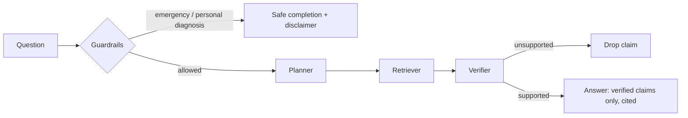

# Healthcare Research Agent — Verified RAG with Citation Checking

> A research assistant for general healthcare questions built on one rule: **no claim reaches the user unless a retrieved source actually supports it.**

**Author:** Amna Raheeba — BS-IT, Government College Women University Faisalabad · Research interests: explainable AI, LLMs, AI for healthcare

> **Not medical advice.** The corpus is a small hand-written *sample* corpus (14 short summaries written for this project). This is an engineering demonstration, not a clinical tool.

---

## 1. Overview

### 1.1 The problem
Most RAG demos retrieve chunks, hand them to an LLM, and print the result — citations included, whether or not the cited source supports the sentence. In healthcare that is a safety problem: a fabricated threshold or invented dose looks exactly as authoritative as a real one.

### 1.2 The idea
Put a **verifier between generation and output**, run **medical guardrails before retrieval**, and keep the whole pipeline pure Python — no API key, no embeddings service, no framework — so anyone can read, run, and test it.

## 2. How It Works

### 2.1 Pipeline



### 2.2 The stages

| Stage | What it does |
|---|---|
| **Guardrails** | Detects emergency language and personal-diagnosis requests before anything else; every answer carries a disclaimer |
| **Planner** | Breaks the question into sub-queries with an auditable expansion table (e.g. "diabetes" → also searches HbA1c, fasting glucose) |
| **Retriever** | Pure-Python BM25 with a relative relevance cutoff, so weak generic matches don't leak off-topic citations into answers |
| **Verifier** | Checks each claim against its cited chunk — wording **and numbers separately**, so an invented HbA1c of 9.9% is rejected |
| **Answer** | Abstention gate first (below); if the evidence is strong enough, composes strictly from verified claims, each with a `[n]` citation and a source list |

### 2.3 Key concepts

- **Selective answering** — verification alone is not enough: a question the corpus barely touches can still produce claims that verify against irrelevant chunks. So after verification, an evidence-strength score (verifier support of usable claims, question coverage, retrieval saturation) is compared with a configurable threshold, and below it the agent *abstains* — "the sample corpus doesn't contain enough verified evidence to answer this reliably" — instead of composing a weak answer.
- **Extractive by default** — sentences come from sources, so they can be verified exactly. An optional LLM adapter exists, but its output must pass the same verifier.
- **BM25 first, vectors later** — deterministic and debuggable; a `VectorIndex` interface in the retriever is the seam for FAISS/Chroma at larger scale.
- **Every step traced** — run with `--show-trace` to see timing and decisions per stage.

## 3. Quick Start

```bash
# Python 3.10+, standard library only
python -m health_agent "When should adults be screened for type 2 diabetes and which tests are used?"
python -m health_agent "How can sepsis be recognised early?" --show-trace
python -m health_agent "Do I have diabetes? Diagnose me"   # guardrail refusal

pip install pytest && pytest -q                            # 19 tests
python -m health_agent.evaluation.evaluate                 # bundled eval set
python -m health_agent.evaluation.risk_coverage            # abstention sweep -> results/
```

**Example answer** (from [`examples/example_qa.md`](examples/example_qa.md)):

> Adults aged 35 to 70 years who have overweight or obesity should be screened for type 2 diabetes… Screening can be performed with HbA1c, fasting plasma glucose, or a 75 g oral glucose tolerance test. [1]

## 4. Project Structure

```
health_agent/
├── graph.py / state.py         # pipeline runner · shared AgentState
├── guardrails.py               # emergency + personal-diagnosis checks, disclaimer
├── abstention.py               # selective answering: evidence-strength score + threshold gate
├── config.py / observability.py / llm.py   # config · per-step trace · optional LLM adapter
├── agents/
│   ├── planner.py              # sub-queries + facet expansion
│   ├── retriever.py            # BM25 + relevance cutoff + VectorIndex interface
│   ├── verifier.py             # claim-vs-source checking, incl. numeric claims
│   └── answer.py               # verified claims only, with citations
├── tools/corpus.py             # JSONL corpus loading / validation
└── evaluation/                 # recall, citation precision, faithfulness
data/corpus.jsonl               # 14 sample summaries (diabetes, hypertension,
                                # sepsis, radiology AI, screening, CKD, stroke…)
tests/                          # retrieval · verifier · guardrails · abstention · end-to-end
notebooks/                      # 01 retrieval failure analysis · 02 risk-coverage experiment
results/                        # risk_coverage.csv / .png, generated by the evaluation
docs/experiment_log.md          # dated working notes behind the design choices
```

## 5. Design Decisions

| Decision | Why |
|---|---|
| Verifier after generation, not before | Retrieval alone cannot stop a plausible but unsupported sentence; checking the final claims can. |
| Numbers verified separately | Invented statistics and thresholds are the highest-risk failure in medical QA. |
| Guardrails first, disclaimer always | A personal-diagnosis or emergency request should never reach retrieval at all. |

## 6. Evaluation

On the bundled 6-question eval set against the sample corpus: **retrieval recall 1.00 · citation precision 1.00 · faithfulness 1.00**.

> Honest context: the set is tiny and in-domain, and the default answerer is extractive, so high faithfulness is expected by construction. The verifier earns its keep on claims that did *not* come from a source — see `tests/test_verifier.py`, where fabricated claims are correctly rejected. Treat this as a pipeline regression check, not a real-world medical QA claim.

**Selective answering (risk–coverage).** Adding 6 out-of-corpus questions the sample corpus cannot answer (specific drug dosages, paediatric dosing, rare diseases) and sweeping the abstention threshold: at threshold 0 the system answers 11/12 questions and 5 of those answers are unsupported (**risk 0.455 at coverage 0.917**); at the default threshold 0.62 it answers only the 6 in-corpus questions, all correctly (**risk 0.0 at coverage 0.5**). Full table in [`results/risk_coverage.csv`](results/risk_coverage.csv), plot in `results/risk_coverage.png`. Twelve hand-picked questions prove the mechanism, not its calibration — the margin between the strongest out-of-corpus score (0.596) and the weakest in-corpus one (0.634) is narrow, and the threshold will need re-calibrating as the corpus grows.

## 7. Limitations & Roadmap

**Limitations:** sample corpus only (answers say so when a topic is missing) · lexical verification is not semantic understanding — it can miss a wrong-meaning claim or reject a correct paraphrase · guardrails are pattern-based.

**Roadmap:** ~~selective answering with risk–coverage evaluation~~ ✓ done in v0.2.0 · entailment (NLI) verifier alongside the lexical check · hybrid dense retrieval behind the `VectorIndex` interface · real guideline-PDF ingestion with page-level citations · larger clinician-reviewed eval set.

## License

MIT © 2026 Amna Raheeba — see [LICENSE](LICENSE).
